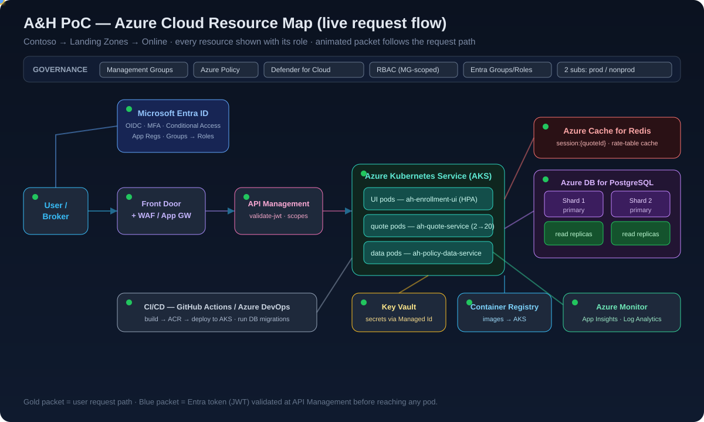
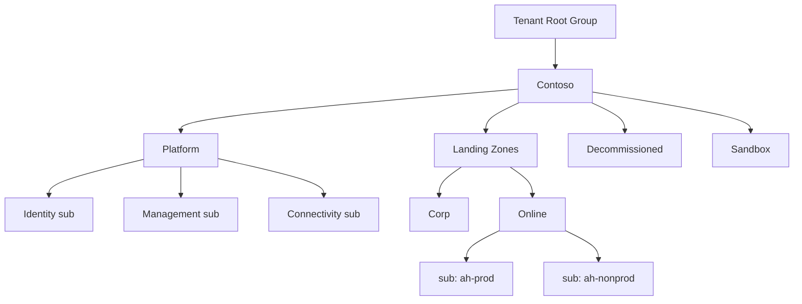
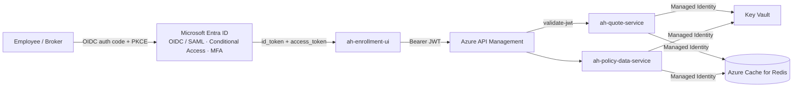
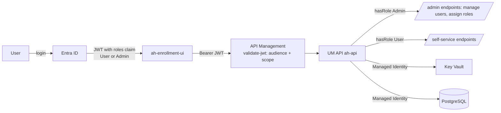

# Cloud Requirements — A&H Mass Rate-Quote Scalability PoC

Shared Azure platform blueprint for all four repos:
`ah-enrollment-ui` · `ah-quote-service` · `ah-policy-data-service` · `ah-db-migrations`.

This document is copied identically into every repo so each service ships with the same
platform contract.

---

## Cloud resource map (animated)



> Open the SVG for the live loop: the **gold packet** follows a user request
> (User → Front Door/WAF → API Management → AKS pods → Redis → PostgreSQL), and the
> **blue packet** is the Entra ID token validated at API Management before any pod is reached.

## Every resource, animated



> One animated tile per cloud resource we create — AKS autoscaling, Redis cache-hit gauge,
> PostgreSQL shard replication, Entra group→role mapping, API Management JWT check,
> Front Door/WAF allow-vs-block, Key Vault secret delivery, ACR image push, and live
> Azure Monitor telemetry.

---

## 1. Business context

During **Annual Open Enrollment (Q4)**, brokers upload 50,000+ employee census files at once.
Traffic spikes from **~50 rps to 15,000+ rps within minutes**. The platform must scale out,
preserve in-progress quotes, and keep the database write path free.

---

## 2. Management-group hierarchy (Contoso)



**Where to create this project:** under `Contoso → Landing Zones → Online`
(internet-facing workload).

---

## 3. Subscriptions & resource groups

| Subscription | Purpose | Resource groups |
|---|---|---|
| `sub-ah-nonprod` | dev / test / staging | `rg-ah-dev`, `rg-ah-test`, `rg-ah-stg` |
| `sub-ah-prod` | production | `rg-ah-prod-app`, `rg-ah-prod-data`, `rg-ah-prod-network`, `rg-ah-prod-shared` |

> **Subscription** = isolation + quota + billing boundary.
> **Resource group** = lifecycle boundary (created/deleted together).

---

## 4. Single Sign-On (Microsoft Entra ID)



- **Human sign-in:** Entra ID, **OIDC (auth code + PKCE)** for the SPA, **Conditional Access +
  MFA**, **B2B** for external brokers (or **Entra External ID** for consumer scale).
- **Service-to-service:** **Managed Identities** — no secrets in code; DB creds pulled from
  **Key Vault**.
- **API edge:** **Azure API Management** `validate-jwt`, scope enforcement before any pod.
- **RBAC:** group-based app roles — `Employee`, `Broker`, `Underwriter`, `HR-Admin`.

---

## 5. Cloud resources to create

| Layer | Azure resource |
|---|---|
| Compute | **AKS** (one cluster per env); node pools for UI / quote / data |
| Identity / SSO | **Microsoft Entra ID**, App Registrations, **Managed Identities**, Conditional Access |
| API edge | **Azure API Management**, **Application Gateway + WAF** / Front Door |
| Cache + session | **Azure Cache for Redis** (Premium, clustered) |
| Database | **Azure Database for PostgreSQL – Flexible Server** (primary + read replicas, sharded) |
| Secrets | **Azure Key Vault** |
| Networking | **VNet**, private endpoints, hub-spoke via Connectivity sub |
| Registry | **Azure Container Registry (ACR)** |
| Observability | **Azure Monitor + Log Analytics + Application Insights** |
| CI/CD | **GitHub Actions / Azure DevOps** → ACR → AKS |
| Governance | **Azure Policy**, management-group-scoped **RBAC**, **Microsoft Defender for Cloud** |

---

## 6. Per-repo cloud mapping

| Repo | Primary Azure resources | Scaling mechanism |
|---|---|---|
| `ah-enrollment-ui` | AKS (stateless UI pods), Front Door/App Gateway, Entra ID | HPA 2→N pods, no sticky sessions |
| `ah-quote-service` | AKS, Azure Cache for Redis | HPA 2→20 pods, read-aside cache |
| `ah-policy-data-service` | AKS, PostgreSQL Flexible Server (replicas + shards), Key Vault | Read-replica routing + write sharding |
| `ah-db-migrations` | PostgreSQL Flexible Server (sharded primaries + replicas) | Versioned migrations per shard |

---

## 7. Non-functional requirements

| Area | Target |
|---|---|
| Peak throughput | 15,000+ rps sustained during Open Enrollment |
| Quote latency | < 15 ms (cache hit), < 150 ms (cache miss) |
| Availability | 99.95% (multi-zone AKS + zone-redundant data tier) |
| Session durability | `session:{quoteId}` in Redis, 30-min TTL, survives pod loss |
| Secrets | Zero secrets in code — Managed Identity + Key Vault only |
| Network | Private endpoints for data + cache; public ingress only via WAF |
| Observability | Distributed tracing (App Insights), centralized logs (Log Analytics) |

---

## 8. User Management (UM) & group-based RBAC

A scalable, **dynamic** User Management module where privileges are driven entirely by
**Microsoft Entra ID security-group membership** — no privilege logic hard-coded in the app.

### App Registrations required

| App Registration | Type | Responsibility |
|---|---|---|
| `ah-enrollment-ui` (SPA) | Public client (SPA) | OIDC auth code + PKCE login; requests API scopes |
| `ah-api` (UM / backend) | Web API | **Exposes scopes** (`UM.Read`, `UM.Manage`) and defines **App Roles** (`User`, `Admin`); validates tokens |

> Service-to-service calls (pods → DB / cache / Key Vault) use **Managed Identities**, not app
> registrations or secrets.

### Entra security groups → app roles

| Entra security group | App role (claim) | Privileges in UM |
|---|---|---|
| `grp-ah-users` | `User` | Self-service: view own profile, enrollments, quotes |
| `grp-ah-admins` | `Admin` | Full UM: list/search users, assign roles, disable accounts, view audit log |

- Map each group to its app role under **Enterprise Application → Users and groups**, and emit
  it via the **App Roles** / **groups** token claim.
- Make it *dynamic* with **Entra dynamic membership rules** (attribute-driven), so adding a user
  to `grp-ah-admins` instantly grants admin — zero code or redeploy.

### End-to-end RBAC flow



### Per-API enforcement (reference)

```java
// Admin-only: manage users / assign roles
@PreAuthorize("hasRole('Admin')")
@PostMapping("/api/um/users/{id}/roles")
public void assignRole(@PathVariable String id, @RequestBody RoleChange c) { ... }

// Any authenticated user: own profile
@PreAuthorize("hasAnyRole('User','Admin')")
@GetMapping("/api/um/me")
public UserProfile me(Authentication auth) { ... }
```

- **APIM** rejects tokens with a wrong/absent audience or scope before reaching a pod.
- The **UM API** enforces the `roles` claim per endpoint; an `Admin` endpoint returns **403** for
  a `User` token.
- RBAC scales horizontally with the stateless pods — the token is self-contained, so any pod
  authorizes any request without a central session lookup.

### Extra cloud resources for UM

| Need | Azure resource |
|---|---|
| Groups, app roles, dynamic membership | **Microsoft Entra ID** (`grp-ah-users`, `grp-ah-admins`) |
| Token validation at the edge | **Azure API Management** (`validate-jwt`) |
| UM data (user profiles, role-assignment audit) | **PostgreSQL** table `um_user`, `um_role_audit` (in `ah-db-migrations`) |
| Secrets / signing config | **Key Vault** via Managed Identity |
