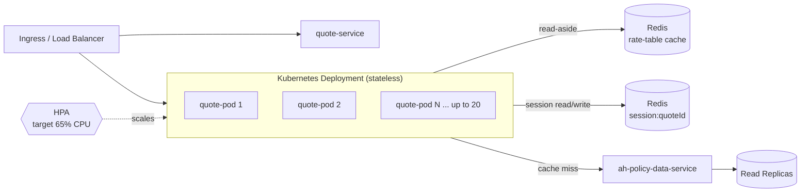

# ah-quote-service

> **Role:** The heavily scaled, **stateless** API that processes complex A&H actuarial
> calculations and builds temporary quotes during the Annual Open Enrollment rate-quote spike
> (50 rps → 15,000+ rps in minutes).

Part of the **A&H Mass Rate-Quote Scalability PoC**:
[`ah-enrollment-ui`](../ah-enrollment-ui) · **`ah-quote-service`** ·
[`ah-policy-data-service`](../ah-policy-data-service) · [`ah-db-migrations`](../ah-db-migrations)

---

## Scaling in action



> The animation above (open the SVG for the live loop) shows the Horizontal Pod Autoscaler
> taking the deployment from **2 → 20 pods** as ingress traffic climbs from **50 → 15,000 rps**,
> while the Redis rate-table cache holds a **90%+ hit ratio**.

---

## Architecture



### Why each layer exists

| Concern | Mechanism | Payoff |
|---|---|---|
| **Scale-out** | Stateless pods behind HPA (CPU + HTTP rps) | Absorbs the Q4 spike linearly; any pod serves any request |
| **In-progress quote state** | `session:{quoteId}` in Redis, TTL 30m | Pods can die/restart mid-quote with zero data loss |
| **Hot actuarial lookups** | Read-aside cache `cache:rates:state:NJ:plan:AH-GOLD` | ~80% fewer DB reads, quote latency < 15 ms |

---

## Scaling process (step by step)

1. **Baseline** — 2 pods serve ~50 rps. HPA idle.
2. **Spike begins** — brokers upload 50k+ census files; CPU + rps cross the HPA target.
3. **Scale-out** — HPA adds pods in waves until the deployment reaches `maxReplicas: 20`.
4. **Cache warms** — first requests miss Redis and hit `ah-policy-data-service`; subsequent
   requests hit the cache (90%+), so the DB stays free for writes.
5. **Session durability** — every wizard step reads/writes `session:{quoteId}`; killing a pod
   simply re-routes the next request, which rehydrates state from Redis.
6. **Scale-in** — after the spike, HPA drains pods back toward `minReplicas: 2`.

```yaml
# k8s/hpa.yaml (reference)
apiVersion: autoscaling/v2
kind: HorizontalPodAutoscaler
metadata: { name: ah-quote-service }
spec:
  scaleTargetRef: { apiVersion: apps/v1, kind: Deployment, name: ah-quote-service }
  minReplicas: 2
  maxReplicas: 20
  metrics:
    - type: Resource
      resource: { name: cpu, target: { type: Utilization, averageUtilization: 65 } }
```

---

## Local run

```bash
# Redis for session + cache
docker run -p 6379:6379 redis:7

# Quarkus dev mode (or ./mvnw spring-boot:run for Spring Boot)
./mvnw quarkus:dev
```

## Azure deployment target

Deployed to **Azure Kubernetes Service (AKS)** with **Azure Cache for Redis** (Premium, clustered).
See the platform landing-zone and SSO notes in [`ah-enrollment-ui`](../ah-enrollment-ui#azure-enterprise-landing-zone).
